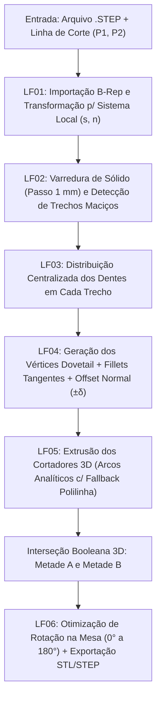

# Documentação Técnica e de Produto: Software Interativo de Corte 3D com Encaixes Mecânicos (*Dovetail Studio*)

---

## 1. Análise de Viabilidade: É uma boa ideia para Impressão 3D?

**Sim, é uma excelente ideia** — tanto como ferramenta prática de engenharia quanto como produto comercial, software open-source ou projeto acadêmico (TCC / Iniciação Científica).

### 1.1. A Dor Real do Mercado
Impressoras 3D de bancada (como **Bambu Lab A1/P1S/X1C** com $256 \times 256\text{ mm}$, **A1 Mini** com $180 \times 180\text{ mm}$ ou **Ender 3** com $220 \times 220\text{ mm}$) têm precisão e resistência para fabricar peças estruturais reais (chassis de robôs, aeromodelos, carenagens, gabaritos industriais). Porém, qualquer peça que ultrapasse o limite físico da mesa exige divisão e colagem.

### 1.2. Limitações das Ferramentas Atuais vs. Proposta do Software

| Ferramenta Atual | Como funciona hoje | Por que deixa a desejar? | Como o nosso software resolve |
| :--- | :--- | :--- | :--- |
| **Fatiadores (Bambu Studio, OrcaSlicer, PrusaSlicer)** | Corte planar simples com adição manual de 1 pino ou 1 *dovetail* por vez. | • Não cria uma **costura multi-dentes contínua**.<br>• Não desvia sozinho de furos de parafuso.<br>• Só opera em malha (`.stl`), não exporta `.step` de volta para o CAD. | Gera dezenas de dentes *rabo de andorinha* arredondados automaticamente ao longo da linha, pula furos sozinho e exporta `.STL` e `.STEP`. |
| **CAD Tradicional (Inventor, SolidWorks, Fusion 360)** | Desenho manual do esboço de cada dente, *fillets*, *offset* de folga e *split solid*. | • Leva de **20 a 45 minutos** por peça.<br>• Mudar o corte de vertical para diagonal exige refazer o esboço inteiro do zero. | O usuário **arrasta uma linha com o mouse** e testa cortes verticais, horizontais ou diagonais em **2 segundos**. |
| **Luban3D / Meshmixer** | Divide esculturas em blocos com pinos. | • Focados em modelos artísticos/cosplay, sem precisão mecânica B-Rep (`.step`). | Focado em **engenharia e peças estruturais** com alto *grip* mecânico e resistência a impacto. |

---

## 2. Regras de Negócio (RN)

As regras abaixo definem o comportamento obrigatório do sistema para garantir que nenhuma peça gerada falhe na impressão ou na montagem mecânica:

### RN01 — Preservação de Integridade Funcional (Proteção Automática de Furos)
Nenhum dente do encaixe pode invadir furos de parafuso, rasgos oblongos, cavidades internas ou bordas externas da peça. Todo dente aprovado deve possuir uma parede mínima de plástico 100% maciço ao seu redor:
- **Margem longitudinal nas pontas (`MARGEM_BORDA`):** mínimo de $2,5\text{ mm}$ antes do início e após o fim da cabeça do dente.
- **Margem transversal de parede (`MARGEM_PAREDE`):** mínimo de $1,6\text{ mm}$ além da base e do topo do dente.
- Caso haja um furo no caminho da linha de corte, o sistema **suprime automaticamente o dente naquela posição**, mantendo o corte reto ao atravessar o furo e retomando os dentes no próximo trecho maciço.

### RN02 — Travamento Mecânico Bidirecional (Geometria *Dovetail*)
O ângulo de inclinação das paredes laterais do dente ($\beta$, `ANGULO_DOVETAIL`) deve ser estritamente agudo em relação à linha de corte, restrito ao intervalo:
$$45^\circ \le \beta \le 65^\circ \quad (\text{padrão: } 55^\circ)$$
Isso garante que a largura da cabeça ($W_{\text{head}}$) seja sempre maior que a largura do pescoço ($W_{\text{neck}}$), criando um travamento mecânico positivo (*undercut*) que impede a separação das metades tanto por **tração perpendicular** quanto por **cisalhamento lateral**.

### RN03 — Isonomia Estrutural entre Dente Macho e Fêmea
O passo centro-a-centro ($P$, `PASSO_DENTES`) entre dois dentes consecutivos nunca pode deixar o vão intermediário (que forma o dente da outra metade) mais estreito que o pescoço do dente principal. A regra obrigatória é:
$$P \ge W_{\text{head}} + W_{\text{neck}}$$
Quando $P = W_{\text{head}} + W_{\text{neck}}$, os dentes da Metade A e os dentes da Metade B possuem **exatamente as mesmas dimensões e a mesma resistência mecânica**, eliminando um "elo fraco" na costura.

### RN04 — Eliminação de Concentradores de Tensão (*Fillet* Tangente Obrigatório)
Peças impressas em 3D sofrem delaminação ou trinca sob impacto quando possuem cantos vivos internos ($90^\circ$ ou agudos). Todos os 4 cantos de cada trapezoide (2 na base do pescoço e 2 no topo da cabeça) devem receber arredondamento circular tangente ($C^1$) com raio $R_{\text{fillet}}$ (`RAIO_CANTO`), limitado dinamicamente por:
$$R_{\text{max}} = 0,42 \cdot \min(L_{\text{seg},1}, L_{\text{seg},2}) \cdot \tan\left(\frac{\gamma}{2}\right)$$
Isso impede que dois arcos vizinhos se cruzem ou gerem auto-interseção na malha, mesmo que o usuário configure dentes muito pequenos.

### RN05 — Folga Perpendicular Uniforme (*True Normal Parallel Offset*)
Para que o encaixe tenha *grip* mecânico uniforme em toda a volta do dente, a folga total (`FOLGA_ENCAIXE`, padrão $0,18\text{ mm}$) não pode ser um simples deslocamento em X ou Y. Ela deve ser aplicada como um **offset paralelo normal de $\pm \delta$** ($\delta = \text{FOLGA\_ENCAIXE} / 2$) perpendicular a cada segmento de reta e concêntrico a cada arco de *fillet*.
- **Faixas de folga recomendadas pelo sistema:**
  - `0,14 a 0,16 mm`: *Press-fit* (encaixe sob pressão forte / interferência leve).
  - `0,18 mm`: Padrão calibrado para Bambu Lab A1 (desliza firme em Z com alto *grip* + camada fina de cola).
  - `0,22 a 0,25 mm`: Folga livre para colas mais viscosas (epóxi bicomponente) ou impressoras sem calibração de fluxo.

### RN06 — Validação de Volume de Impressão e Auto-Aninhamento (*Auto-Nesting*)
Após dividir a peça em Metade A e Metade B, o sistema deve testar rotações no plano XY ($\theta \in [0^\circ, 180^\circ)$) para cada metade. O corte só recebe status **Aprovado para a Impressora** se ambas as metades cumprirem:
$$\max(\Delta X_{\text{rot}}, \Delta Y_{\text{rot}}) \le L_{\text{mesa}} - 2 \cdot M_{\text{mesa}}$$
*(Para a Bambu Lab A1 com mesa de $256\text{ mm}$ e margem de $5\text{ mm}$, o limite útil é de $246 \times 246\text{ mm}$).*

### RN07 — Alerta de Fragmentação (*Multi-Body Detection*)
Se a linha traçada pelo usuário atravessar um vão aberto (como o interior dos braços em "V" do chassi) de modo que uma das metades se divida em 2 ou mais pedaços desconectados ($\text{nº de sólidos} > 1$ em uma mesma metade), o sistema deve exibir um **Alerta de Fragmentação** na interface antes de salvar, informando quantos fragmentos soltos foram gerados.

### RN08 — Normalização de Escala e Apoio Automático na Mesa (`Z = 0`)
- Caso um arquivo `.STEP` exportado em centímetros apresente dimensões incompatíveis com a escala em milímetros, o sistema converte automaticamente para $\text{mm}$.
- Toda metade exportada é transladada automaticamente para que sua face inferior fique apoiada em $Z = 0$ e posicionada no quadrante positivo $(X \ge 0, Y \ge 0)$, pronta para fatiar sem precisar ajustar altura no fatiador.

### RN09 — Imutabilidade do Arquivo Original e Organização de Pastas
O arquivo original nunca é alterado. As saídas são salvas na pasta definida pelo usuário, gerando pares sincronizados `NomePeca_A.stl`, `NomePeca_B.stl` (para impressão imediata) e `NomePeca_A.step`, `NomePeca_B.step` (para edição/documentação em CAD).

### RN10 — Geração de Corpo de Prova Rápido (*Mini-Teste de Grip*)
O usuário pode exportar a qualquer momento um pequeno bloco de calibração ($28 \times 22 \times 5\text{ mm}$) contendo **1 único par macho/fêmea** gerado com os mesmos parâmetros ativos, permitindo validar a folga real da impressora e do filamento em 10 minutos antes de imprimir a peça grande.

---

## 3. Lógicas de Funcionamento e Algoritmos Matemáticos (LF)



### LF01 — Sistema de Coordenadas Local da Linha de Corte $(s, n)$
Quando o usuário traça uma linha de corte entre $P_1 = (x_1, y_1)$ e $P_2 = (x_2, y_2)$ (ou define um ponto $(x_0, y_0)$ e ângulo $\alpha$):
1. Calcula-se o vetor unitário tangente $\vec{t} = (\cos\alpha, \sin\alpha)$ e o vetor unitário normal à esquerda $\vec{n} = (-\sin\alpha, \cos\alpha)$.
2. Qualquer ponto no espaço 2D da costura é parametrizado por $(s, d)$, onde $s$ é a distância ao longo da linha de corte e $d$ é o afastamento perpendicular:
   $$(X, Y) = (x_0 + s \cdot t_x + d \cdot n_x, \quad y_0 + s \cdot t_y + d \cdot n_y)$$
3. Os 4 cantos do *BoundingBox* da peça são projetados em $\vec{t}$ e $\vec{n}$ para determinar o intervalo total de varredura $[s_{\min}, s_{\max}]$ e os limites laterais $[n_{\min}, n_{\max}]$.

### LF02 — Algoritmo de Detecção de Trechos Maciços (`dente_cabe`)
Para saber se um dente centrado na posição $s_c$ é válido:
1. Constrói-se um prisma retangular de verificação ao redor do envelope completo do dente acrescido das margens de segurança:
   - Comprimento ao longo de $\vec{t}$: $[s_c - (W_{\text{head}}/2 + M_{\text{borda}}), \; s_c + (W_{\text{head}}/2 + M_{\text{borda}})]$
   - Largura ao longo de $\vec{n}$: $[-M_{\text{parede}}, \; H + M_{\text{parede}}]$
   - Altura em $Z$: fatia estrutural da base $[z_{\min} + 0,4\text{ mm}, \; z_{\min} + 2,9\text{ mm}]$
2. Calcula-se o volume da interseção booleana entre a peça e o prisma de teste:
   $$\text{Válido}(s_c) \iff \frac{\text{Volume}(\text{Peça} \cap \text{Prisma})}{\text{Volume}(\text{Prisma})} \ge 0,992$$
3. Se houver qualquer furo, rasgo ou vazio dentro desse envelope, a razão cai abaixo de $0,992$ e a posição $s_c$ é marcada como bloqueada.

### LF03 — Agrupamento em Trechos Contínuos e Centralização Simétrica (`escolher_dentes`)
1. O algoritmo avalia $\text{Válido}(s)$ de $s_{\min}$ até $s_{\max}$ com passo de $1,0\text{ mm}$ e agrupa as posições válidas adjacentes em intervalos contínuos $[s_a, s_b]$.
2. Dentro de cada intervalo contínuo $[s_a, s_b]$ de comprimento $L = s_b - s_a$:
   - Quantidade máxima de dentes que cabem no trecho:
     $$N = 1 + \left\lfloor \frac{L}{P} \right\rfloor$$
   - Posição central de cada dente $k \in \{0, 1, \dots, N-1\}$ centralizada simetricamente no trecho:
     $$s_k = \frac{s_a + s_b}{2} - \frac{(N - 1) \cdot P}{2} + k \cdot P$$

### LF04 — Geometria Analítica do *Dovetail*, *Fillets* e *Offset* Paralelo (`construir_curva_offset`)
1. **Cálculo da largura da cabeça ($W_{\text{head}}$):**
   Dado o pescoço $W_{\text{neck}}$, a altura $H$ e o ângulo agudo $\beta$:
   $$\Delta s = \frac{H}{\tan\beta}, \qquad W_{\text{head}} = W_{\text{neck}} + 2\Delta s$$
2. **Vértices agudos de cada dente $s_k$ no espaço $(s, n)$:**
   $$V_{k,1} = \left(s_k - \frac{W_{\text{neck}}}{2}, 0\right), \quad V_{k,2} = \left(s_k - \frac{W_{\text{head}}}{2}, H\right), \quad V_{k,3} = \left(s_k + \frac{W_{\text{head}}}{2}, H\right), \quad V_{k,4} = \left(s_k + \frac{W_{\text{neck}}}{2}, 0\right)$$
3. **Arredondamento de cantos e Offset Normal $\pm\delta$:**
   Em cada vértice interno $V_i$, com vetores unitários de entrada $\vec{u}_1$ e saída $\vec{u}_2$, normais à esquerda $\vec{n}_1, \vec{n}_2$, sentido de curva $\tau = \text{sinal}(\vec{u}_1 \times \vec{u}_2) \in \{-1, +1\}$ e ângulo interno $\gamma = \arccos(-\vec{u}_1 \cdot \vec{u}_2)$:
   - Distância de recuo dos pontos de tangência: $d_{\text{tan}} = R / \tan(\gamma / 2)$
   - Pontos de tangência na linha central: $T_1 = V_i - d_{\text{tan}}\vec{u}_1$ e $T_2 = V_i + d_{\text{tan}}\vec{u}_2$
   - Centro invariante do arco de *fillet*: $C_i = T_1 + \tau R \vec{n}_1$
   - Quando aplicamos o deslocamento normal $\delta = +\text{ FOLGA}/2$ (Metade B) ou $\delta = -\text{FOLGA}/2$ (Metade A):
     - O centro $C_i$ **permanece exatamente no mesmo ponto**.
     - Os novos pontos de tangência são $T_1(\delta) = T_1 + \delta \vec{n}_1$ e $T_2(\delta) = T_2 + \delta \vec{n}_2$.
     - O raio do arco ajusta-se analiticamente para $R_{\text{eff}} = R - \tau\delta$.
     - Isso garante continuidade tangente $C^1$ perfeita e distância perpendicular exata de $2|\delta|$ em todos os pontos da junta.

### LF05 — Corte Sólido 3D Híbrido (B-Rep Analítico + Fallback Poligonal)
Para cortar o sólido 3D em CadQuery/OpenCASCADE:
1. **Modo Primário (Analítico):** constrói o perfil fechado usando segmentos de reta (`lineTo`) e arcos de círculo exatos de 3 pontos (`threePointArc(T1_off, P_meio, T2_off)`), extrudando de $z_{\min} - 5\text{ mm}$ até $z_{\max} + 5\text{ mm}$. Isso preserva faces cilíndricas reais no arquivo `.STEP`.
2. **Modo Fallback:** se o kernel CAD encontrar tolerância crítica em alguma geometria complexa, o algoritmo reconstrói automaticamente o cortador discretizando cada arco em 14 sub-segmentos (`polyline`), garantindo que o corte nunca falhe.

---

## 4. Especificação de Interface Moderna (UI/UX Design)

Para oferecer uma experiência profissional, limpa e intuitiva, a interface segue o padrão **Dark CAD Studio** (inspirado no *Bambu Studio*, *Shapr3D* e *Figma Dark*).

### 4.1. Paleta de Cores e Estilo Visual (Dark Mode)
- **Fundo Principal (Janela):** `#0B0F19` (Azul-noite profundo)
- **Painéis Laterais e Cards (Containers):** `#111827` / `#1E293B` com bordas sutis `#334155`
- **Cor de Destaque Primária (Ações / Linha Ativa):** `#06B6D4` (Ciano Técnico) e `#3B82F6` (Azul Royal)
- **Dentes Válidos / Status OK:** `#10B981` (Verde Esmeralda)
- **Zonas de Furo / Alerta de Mesa:** `#F59E0B` (Âmbar) / `#EF4444` (Vermelho Coral)
- **Texto Principal e Secundário:** `#F8FAFC` (Branco Gelo) e `#94A3B8` (Cinza Azulado)

### 4.2. Estrutura da Tela (4 Zonas)

```
+-----------------------------------------------------------------------------------+
| [Logo] DOVETAIL STUDIO 3D   [Abrir .STEP]  [Impressora: Bambu Lab A1 (256x256) v] |
+----------------------------------------------------+------------------------------+
|  Presets: [ | Vertical ] [ -- Horizontal ] [ / Diagonal ] [ * Auto-Corte ]        |
|  +----------------------------------------------+  |  PARAMETROS DO ENCAIXE       |
|  |  Mesa 256 x 256 mm                           |  |  +------------------------+  |
|  |       +---------+          +---------+       |  |  | [Preview 2D 1 Dente]   |  |
|  |       |   O      |          |      O  |       |  |  |   ____/‾‾‾‾\____       |  |
|  |       \         \__________/         /       |  |  +------------------------+  |
|  |        \                            /        |  |  Altura do Dente    [5.0 mm] |
|  |         (P1)====/‾\__/‾\__/‾\=====(P2)       |  |  ========O===========        |
|  |          |      Dentes Verdes      |         |  |  Largura Pescoco    [8.0 mm] |
|  |          |     [ Furo Desviado ]   |         |  |  =======O============        |
|  |          +-------------------------+         |  |  Angulo Dovetail     [55.0°] |
|  |                                              |  |  =========O==========        |
|  |  [HUD] 5 dentes ativos | Angulo: -26.6°      |  |  Raio do Canto      [0.9 mm] |
|  |        Metade A: OK    | Metade B: OK (45°)  |  |  Folga (Grip)      [0.18 mm] |
|  +----------------------------------------------+  |  Presets: [Justo][A1][Folga] |
|  Dica: Clique e arraste no desenho para tracar a   |                              |
|  linha de corte, ou arraste os pontos P1 e P2.     |  PASTA DE SAIDA              |
|                                                    |  [Cortes_Personalizados] [...] |
|                                                    |  [ Mini-Teste (10 min) ]     |
|                                                    |  [ CORTAR E SALVAR PECAS ]   |
+----------------------------------------------------+------------------------------+
```

### 4.3. Interações Principais do Usuário
1. **Traçado Livre *Click & Drag* no Canvas:**
   - O usuário clica em qualquer ponto $P_1$ da peça e arrasta até $P_2$.
   - Ao mover o mouse, a linha de corte com os dentes *rabo de andorinha* é redesenhada **ao vivo sobre a peça**, mostrando exatamente onde cada dente vai cair e quais furos foram desviados.
2. **Botões de Preset Rápido (1 Clique):**
   - Botões no topo do canvas (`Vertical`, `Horizontal`, `Diagonal`, `Inverter Lado dos Dentes`) posicionam a linha instantaneamente, permitindo ajuste fino arrastando com o mouse em seguida.
3. **Preview Zoom do Dente (Card Lateral):**
   - Um mini-canvas lateral mostra um zoom de 1 dente com as duas metades e a **folga azul real** entre elas (igual à imagem de referência CAD), atualizando ao vivo conforme o usuário mexe nos sliders de altura, ângulo, raio e folga.
4. **Escolha de Pasta e Exportação com 1 Clique:**
   - Permite escolher onde salvar e gera os arquivos `.STL` e `.STEP` das metades já posicionadas para a mesa da impressora.
